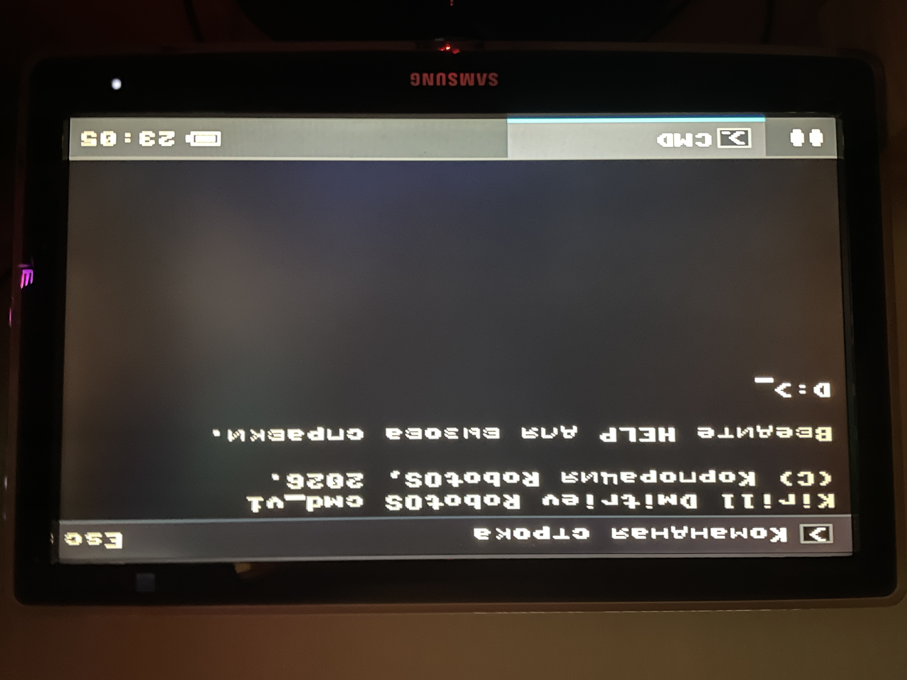
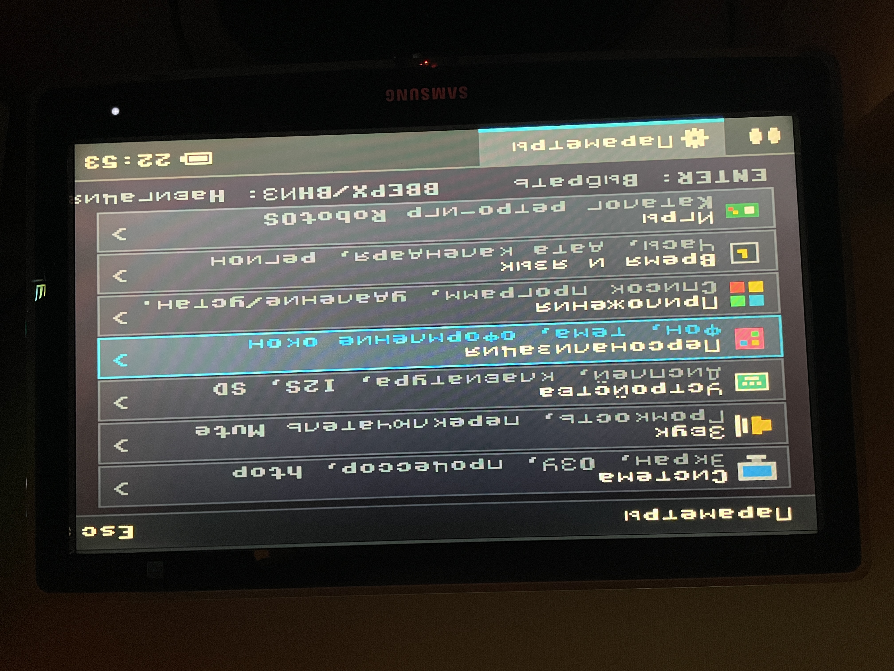
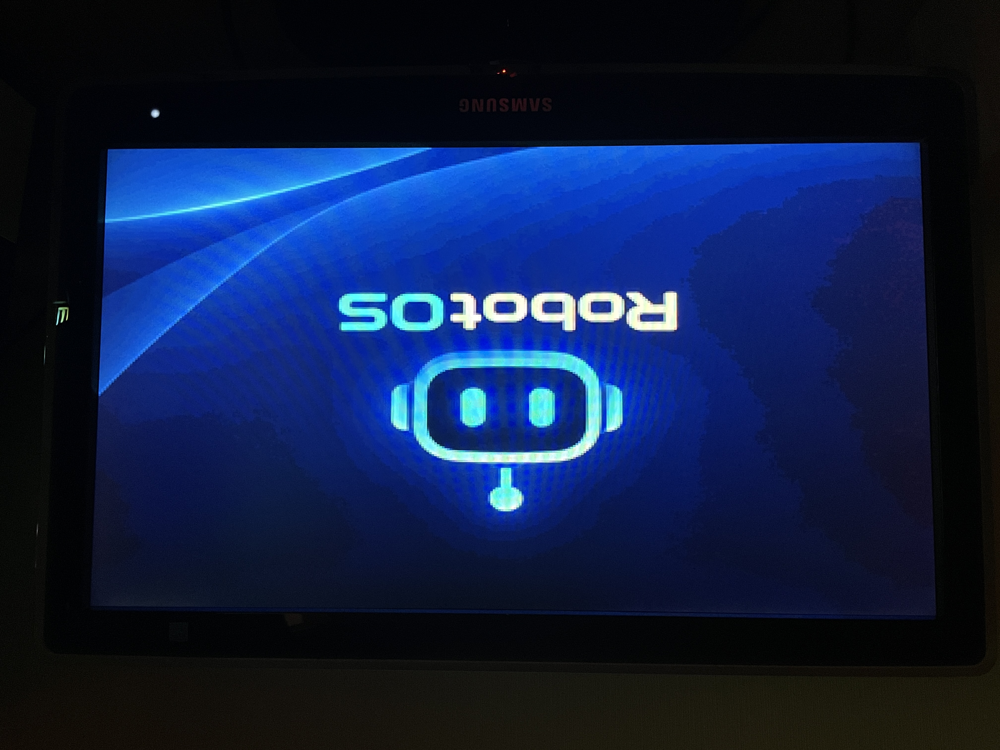
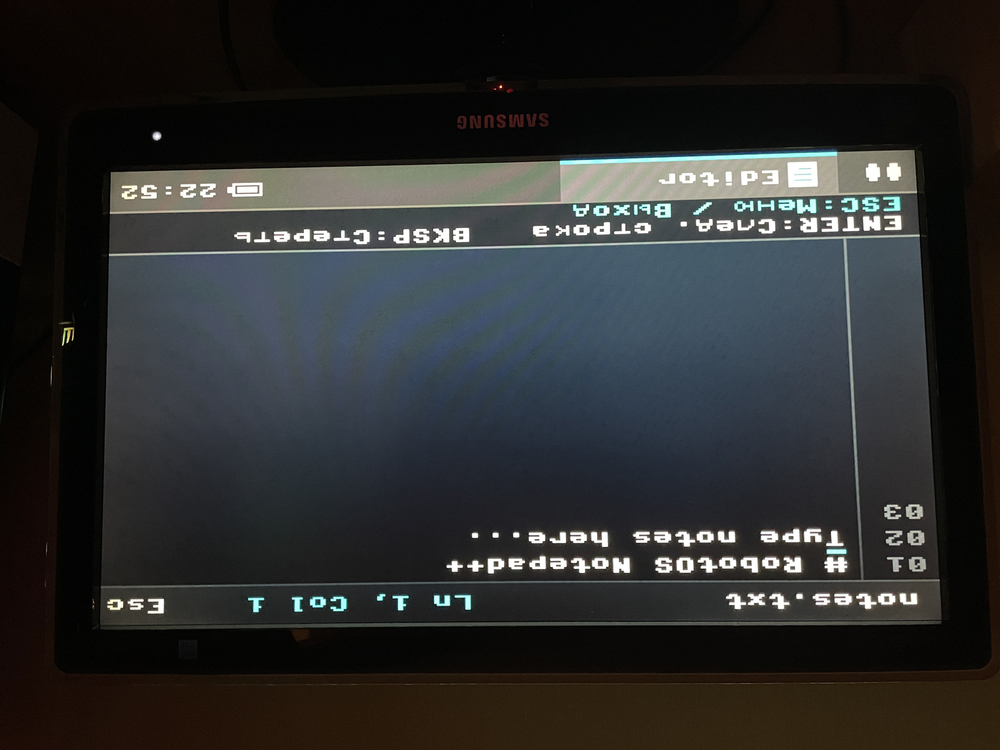
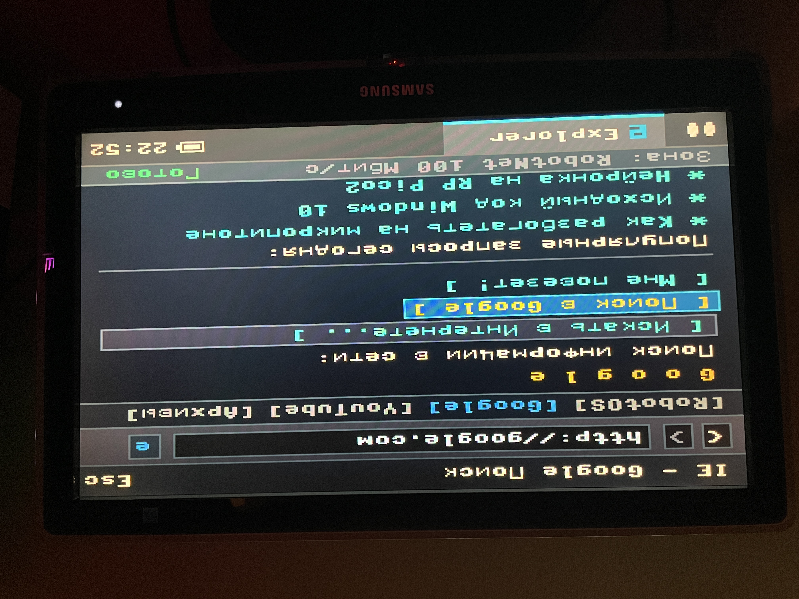
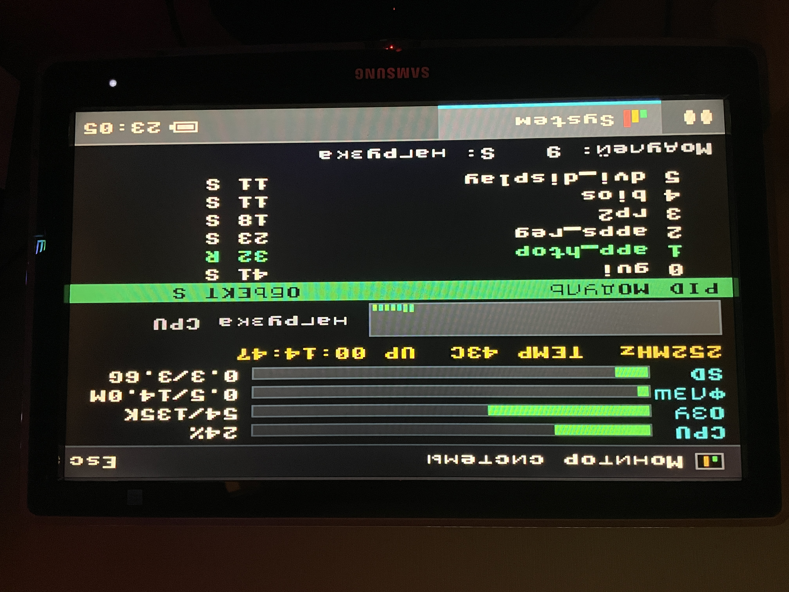

<div align="center">

# 🤖 RobotOS v2.0 — DVI Edition
### Модульная операционная система с GUI для Raspberry Pi RP2350 (DVI / HDMI 320x240 @ 60Hz)


<br/>


<br/>

**RobotOS** — полноценная операционная система с оконным и плиточным интерфейсом для микроконтроллера **Raspberry Pi RP2350B**. 
Генерирует чистый цветной видеосигнал напрямую через аппаратный интерфейс PIO на монитор (DVI/HDMI 320x240 @ 60Hz) без использования видеокарт или внешних контроллеров.

[Смотреть видео на YouTube](#-видео-демонстрация) • [Схема подключения](#-таблица-подключения-40-pin-гребёнка-j5) • [Установка](#-установка-и-прошивка) • [Файловая структура](#-файловая-структура)

</div>

---

## 📺 Видео демонстрация

<div align="center">

[](https://www.youtube.com/watch?v=YOUR_VIDEO_ID)

*(Замените `YOUR_VIDEO_ID` на ID вашего ролика на YouTube)*

</div>

---

## 📸 Галерея системы

<div align="center">
<table>
  <tr>
    <td align="center"><b>Рабочий стол Windows 2000</b></td>
    <td align="center"><b>Плиточный режим Windows 10 (Metro UI)</b></td>
  </tr>
  <tr>
    <td></td>
    <td></td>
  </tr>
  <tr>
    <td align="center"><b>Всплывающий Календарь и Часы</b></td>
    <td align="center"><b>Игровой хаб Xbox Game Pass</b></td>
  </tr>
  <tr>
    <td></td>
    <td></td>
  </tr>
  <tr>
    <td align="center"><b>Видеопроигрыватель WMP (25 FPS)</b></td>
    <td align="center"><b>Метеостанция и Климат</b></td>
  </tr>
  <tr>
    <td></td>
    <td></td>
  </tr>
</table>
</div>

---

## 🌟 Возможности системы

* **Ядро и BIOS**: POST-проверка оборудования, подсчёт SRAM, монтирование MicroSD, опрос линий и фирменный аккорд спикера.
* **Два режима рабочего стола**:
  * **Классический (Windows 2000/10)**: рабочий стол с выбором цвета заливки, ярлыками и меню «Пуск».
  * **Плиточный (Metro UI Windows 10)**: 11 живых плиток (Live Tiles) со швами 3 мм, 3D-переворотом, моргающими глазами робота и каноничными иконками.
* **Панель задач (Taskbar)**:
  * Статус батареи и часы реального времени.
  * Всплывающий календарь с тикающими секундами и сеткой месяца.
  * Индивидуальные пиксельные значки для всех активных приложений.
* **Мультимедиа**:
  * **Видеопроигрыватель (Windows Media Player)**: воспроизведение цветного видео со звуком (апскейл 160x120 $\to$ 320x240 @ 25 FPS).
  * **Аудиоплеер WAV**: чтение русских тегов Windows CP1251, автопоиск по подпапкам, громкость на ассемблере Viper.
  * **Плеер Winamp**: ретро-эквалайзер, спектроанализатор и регулятор баланса.
  * **Полноэкранная Галерея**: моментальное открытие 16/24/32-битных BMP и сырых RAW-картинок за 30 мс.
  * **Интернет-браузер Explorer**: GTA-стиль интерактивного интернета (Google, YouRobot, секретные архивы Пентагона, скачивание ОЗУ).
* **Игры (Xbox Game Pass)**:
  * DOOM-Lite 3D (лучевой кастинг / raycasting).
  * Арканоид (Breakout) с физической сменой скоростей.
  * Кибер-Змейка на арене 30х19 клеток с живыми глазами.
* **Робототехника и Сенсоры**:
  * Мимика робота: 9 анимированных эмоций (Demo и Manual режимы).
  * Метеостанция: считывание BH1750 (свет) и DHT22 (температура/влажность).
  * Пульт шасси: сервоприводы колёс 360° и ковша 180°.
  * Режим сна со скругленными веками и затуханием.
* **Менеджер пакетов и Проводник**:
  * Установка приложений с SD-карты (`/sd/apps`).
  * Безопасное удаление в корзину (`/trash`) с возможностью возврата.
  * Проводник с дисками `C:\` (Flash) и `D:\` (MicroSD).
  * Консоль CMD.EXE с утилитами пинга, взлома и памяти.

---

## 🛠️ Необходимое железо

1. **Плата**: Waveshare RP2350-PiZero (RP2350B, 520KB SRAM + 8MB Flash).
2. **Монитор**: Любой ТВ или монитор с разъёмом HDMI / DVI.
3. **Кабель**: Mini-HDMI $\to$ HDMI (или DVI).
4. **Аудио**: ЦАП I2S **MAX98357A** с динамиком 4–8 Ом (3W).
5. **Клавиатура**: Любая PS/2 клавиатура (или USB через пассивный переходник).
6. **Мышь (опционально)**: Мышь PS/2.
7. **Карта памяти**: MicroSD от 2 ГБ до 32 ГБ (FAT32).
8. **Датчики (опция)**: DHT22, BH1750, ИК-приёмник VS1838B (NEC).
9. **Сервоприводы (опция)**: 2 шт. 360° (колёса), 1 шт. 180° (ковш).

---

## 🔌 Таблица подключения (40-Pin гребёнка J5)

> ⚠️ **ВАЖНО**: На плате Waveshare RP2350-PiZero разъём выполнен в стандарте **Raspberry Pi (BCM)**. Физические номера ножек **НЕ совпадают** с номерами портов GPIO. Подключайте строго по этой таблице:

| Назначение | Сигнал | Физ. пин разъёма | Порт GPIO | Примечание |
| :--- | :--- | :---: | :---: | :--- |
| **Питание** | **+5V (VCC)** | **Пин 2 или 4** | `5V / VBUS` | Питание ЦАП, клавиатуры, мыши |
| | **+3.3V** | **Пин 1 или 17** | `3V3` | Питание сенсоров |
| | **GND (Земля)** | **Пин 6, 9, 14, 20, 25, 30, 34, 39** | `GND` | Общий провод «земли» |
| **Звук I2S** | **BCLK / SCK** | **Пин 19** | `GPIO 10` | Тактовая частота аудио |
| *(MAX98357A)* | **LRC / WS** | **Пин 23** | `GPIO 11` | Выбор канала (левый/правый) |
| | **DIN / SD** | **Пин 32** | `GPIO 12` | Цифровые данные звука |
| **Клавиатура** | **CLK** | **Пин 8** | `GPIO 14` | Аппаратный приём PIO |
| *(PS/2)* | **DATA** | **Пин 10** | `GPIO 15` | Аппаратный приём PIO |
| **Мышь (опция)**| **CLK** | **Пин 18** | `GPIO 24` | Прерывание мыши |
| *(PS/2)* | **DATA** | **Пин 22** | `GPIO 25` | Данные координат |
| | *Земля мыши* | **Пин 20** | `GND` | Пины 18–20–22 идут подряд! |
| **Сенсоры / ДУ**| **ИК-приёмник** | **Пин 5** | `GPIO 3` | Сигнал пульта (NEC) |
| | **BH1750 SDA** | **Пин 7** | `GPIO 4` | I2C0 шина света |
| | **BH1750 SCL** | **Пин 29** | `GPIO 5` | I2C0 такты |
| | **DHT22 Data** | **Пин 33** | `GPIO 13` | 1-Wire температура/влажность |
| **Робот (Серво)**| **Ковш 180°** | **Пин 27** | `GPIO 0` | ШИМ 50 Гц |
| | **Правое колесо**| **Пин 28** | `GPIO 1` | ШИМ 50 Гц (360°) |
| | **Левое колесо** | **Пин 3** | `GPIO 2` | ШИМ 50 Гц (360°) |
| **Впаяно:** | **MicroSD** | *Слот на плате* | `GP30, 31, 40, 43` | Шина SPI1 |
| | **HDMI / DVI** | *Mini-HDMI порт* | `GP16 .. GP23` | PIO2 Видеогенератор |

---

## 📂 Файловая структура

```text
/
├── firmware/
│   └── firmware.uf2              # Готовая официальная прошивка MicroPython для RP2350
├── photo/                        # Обои, фотоматериалы и тестовые картинки
├── lib/                          # Системные аппаратные драйверы
│   ├── dvi_display.py            # Видеодвижок DVI (PIO2 60Hz)
│   ├── dvi_test.py               # Тест монитора и геометрии
│   ├── ps2.py                    # PIO-драйвер клавиатуры
│   ├── ps2_mouse.py              # Драйвер мыши PS/2 с фильтрацией шума
│   ├── sdcard.py                 # Драйвер MicroSD карты (SPI)
│   ├── ir_rx.py                  # Приёмник инфракрасного сигнала
│   ├── nec.py                    # Декодер кодов пульта ДУ
│   └── st7789.py                 # Базовые цветовые константы RGB565
│
├── main.py                       # Точка входа: старт видео, звука, BIOS и рабочего стола
├── bios.py                       # POST загрузчик с тестом памяти и системным аккордом
├── gui.py                        # Оболочка Windows 2000/10 (базовая версия)
├── gui(with mouse).py            # Версия оболочки с курсором мыши и меню ПКМ
├── input_mgr.py                  # Диспетчер ввода (Клавиатура + ИК-Пульт)
├── input_mgr(with mouse).py      # Диспетчер ввода с поддержкой мыши
├── apps_reg.py                   # Реестр установленных приложений
├── app_uninstaller.py            # Менеджер пакетов (установка/удаление/корзина)
├── sites_data.py                 # База веб-страниц для браузера
├── install_readme.txt            # Инструкция по созданию своих приложений
│
└── [ПРИЛОЖЕНИЯ И ИГРЫ]:
    ├── app_cmd.py                # Командная строка CMD.EXE
    ├── app_editor.py             # Текстовый редактор Notepad++
    ├── app_files.py              # Проводник файлов
    ├── app_browser.py            # Браузер Internet Explorer
    ├── app_calendar.py           # Всплывающий календарь и часы над панелью
    ├── app_settings.py           # Параметры системы (звук, дата, оборудование)
    ├── app_metro.py              # Плиточный рабочий стол Windows 10 (11 Tiles)
    ├── app_player.py             # Аудиоплеер WAV (с чтением русских тегов)
    ├── app_winamp.py             # Плеер Winamp со спектром и эквалайзером
    ├── app_video.py              # Видеоплеер Windows Media Player (25 FPS)
    ├── app_gallery.py            # Полноэкранная фотогалерея (BMP, RAW)
    ├── app_htop.py               # Системный монитор ресурсов HTOP
    ├── app_weather.py            # Погода и климат (BH1750 + DHT22)
    ├── app_eyes.py               # Мимика робота (9 эмоций)
    ├── app_sleep.py              # Режим сна с засыпанием век
    ├── app_servo_test.py         # Пульт управления шасси робота
    ├── app_games.py              # Игровой хаб Xbox Game Pass
    ├── app_arkanoid.py           # Арканоид с регулировкой скорости мяча
    ├── app_snake.py              # Кибер-Змейка 30х19 клеток
    └── app_doom.py               # 3D-шутер DOOM-Lite (Raycasting)
```

## 🚀 Установка и прошивка

### 1. Прошивка платы
1. Зажмите кнопку **BOOT** на плате Waveshare RP2350-PiZero.
2. Не отпуская кнопку, вставьте кабель USB в разъём `USB` платы и подключите к ПК. Отпустите кнопку BOOT.
3. В проводнике компьютера появится диск `RP2350`.
4. Перетащите файл `firmware/firmware.uf2` на этот диск. Плата автоматически перезагрузится.

### 2. Загрузка файлов
1. Откройте **Thonny IDE** на компьютере.
2. В правом нижнем углу выберите интерпретатор: `MicroPython (Raspberry Pi Pico)`.
3. Скопируйте папку `lib`, системные файлы и все приложения в корень платы.
> *Если вы хотите использовать мышь, переименуйте `gui(with mouse).py` в `gui.py`, а `input_mgr(with mouse).py` в `input_mgr.py`.*

### 3. Подготовка MicroSD карты
Отформатируйте карту MicroSD в файловую систему **FAT32** и создайте в корне следующие папки:
* `/sd/WAV` — аудиофайлы формата WAV (16-бит, до 44.1 кГц).
* `/sd/video` — видеоролики (`video.raw` и звук `video.wav`).
* `/sd/photo` — картинки (BMP любого типа или 16-бит RAW).
* `/sd/apps` — папка для установки новых сторонних программ.

### 4. Конвертация видео для WMP
Для запуска плавного видео 25 кадров/сек со звуком сконвертируйте любой ролик MP4 через утилиту FFmpeg:

`ffmpeg -i input.mp4 -vf "scale=160:120" -r 25 -pix_fmt rgb565le -f rawvideo video.raw`

`ffmpeg -i input.mp4 -vn -ar 22050 -ac 1 video.wav`

Положите `video.raw` и `video.wav` в папку `/sd/video` на карте памяти.

---

## 🎮 Управление

* **Навигация по рабочему столу**: стрелки `ВВЕРХ / ВНИЗ`.
* **Переход на Часы**: с кнопки «Пуск» нажать стрелку `ВПРАВО`.
* **Открыть Календарь**: нажать `ENTER` на часах или горячую клавишу `C`.
* **Открыть меню «Пуск»**: нажать `ENTER` на кнопке Пуск или клавишу `ESC`.
* **Плиточный режим (Metro UI)**: переключается в `Параметры -> Персонализация -> Режим стола: < Плитки Win10 >`.
* **В приложениях**:
  * `ESC` / `BACK` — выход назад / закрытие окна программы.
  * `ПРОБЕЛ` — пауза в плеерах / огонь в играх.
  * `O` (латинская) — открыть проводник папок в Музыке и Галерее.
  * `ВВЕРХ / ВНИЗ` — громкость (+/- 5%).
  * `ВЛЕВО / ВПРАВО` — переключение треков, фото или поворот в 3D.

---

## ⚠️ Лицензия и ограничения на использование
Этот проект распространяется по лицензии **Creative Commons Attribution-NonCommercial-ShareAlike 4.0 (CC BY-NC-SA 4.0)**.

* **РАЗРЕШЕНО**: Личное использование, обучение, хобби-проекты, домашние эксперименты.
* **СТРОГО ЗАПРЕЩЕНО**: Коммерческое использование, предустановка на продаваемые устройства, перепродажа прошивки или её компонентов без согласия автора.

<div align="center">

# 🤖 RobotOS v2.0 — DVI Edition
### Modular GUI Operating System for Raspberry Pi RP2350 (DVI / HDMI 320x240 @ 60Hz)


<br/>


<br/>

**RobotOS** is a complete, modular, windowed operating system with a graphical user interface (GUI) designed for the **Raspberry Pi RP2350B** microcontroller.
It generates direct color video over an onboard HDMI/DVI port using RP2350 PIO state machines (320x240 @ 60Hz) without any external video cards or GPUs.

Author: **Kirill Dmitriev**, 2026.

[YouTube Demo](#-video-demonstration) • [Wiring & Pinout](#-pinout-and-wiring-table-40-pin-header-j5) • [Installation Guide](#-installation--flashing) • [File Architecture](#-file-architecture) • [License](#️-license-and-terms-of-use)

</div>

---

## 📺 Video Demonstration

<div align="center">

[](https://www.youtube.com/watch?v=YOUR_VIDEO_ID)

*(Replace `YOUR_VIDEO_ID` with your real YouTube video ID)*

</div>

---

## 📸 System Screenshots

<div align="center">
<table>
  <tr>
    <td align="center"><b>Windows 2000 Classic Desktop</b></td>
    <td align="center"><b>Windows 10 Metro Live Tiles UI</b></td>
  </tr>
  <tr>
    <td></td>
    <td></td>
  </tr>
  <tr>
    <td align="center"><b>Calendar & Clock Popup Widget</b></td>
    <td align="center"><b>Xbox Game Pass Hub</b></td>
  </tr>
  <tr>
    <td></td>
    <td></td>
  </tr>
  <tr>
    <td align="center"><b>WMP Video Player (25 FPS)</b></td>
    <td align="center"><b>Weather & Climate Station</b></td>
  </tr>
  <tr>
    <td></td>
    <td></td>
  </tr>
</table>
</div>

---

## 🌟 Key Features

* **Kernel & BIOS POST**: Hardware initialization test, memory verification, SD check, system speaker beep, and signature power-on chime.
* **Dual Desktop Modes**:
  * **Classic Mode (Windows 2000/10)**: Classic desktop with customizable background colors, desktop icons, and Windows Start menu.
  * **Live Tiles Mode (Windows 10 Metro UI)**: Interactive 11-tile mosaic with tight 3px gaps, 3D flip animations, real-time blinking robot eyes, and live widgets.
* **Taskbar & Navigation**:
  * Battery indicator and real-time clock.
  * Flyout calendar widget in the bottom-right corner with live ticking seconds and month navigation.
  * Taskbar tabs with custom pixel-art icons for every open application.
* **Multimedia**:
  * **Windows Media Player**: Smooth color video playback with synced I2S audio (160x120 upscaled to 320x240 @ 25 FPS).
  * **WAV Audio Player**: Subfolder scanner, Windows CP1251 Cyrillic tag decoding, hardware volume scaling via ARM Cortex-M33 Viper code.
  * **Winamp Classic**: Iconic MP3/WAV player skin with real-time spectrum visualizer and 3-band equalizer.
  * **Fullscreen Photo Gallery**: Instant 30ms loading for 16-bit RAW and universal 16/24/32-bit BMP files without borders.
  * **Internet Explorer**: GTA-style fake web browser with interactive hyperlinks (Google, YouRobot, Pentagon Archives, Free RAM Downloader).
* **Xbox Game Pass Hub**:
  * Carousel game library with illustrated cover posters.
  * DOOM-Lite 3D (raycasting engine).
  * Arkanoid (Breakout) with 5 physical ball speed profiles.
  * Cyber-Snake on a widescreen 30x19 arena with direction-aware eyes.
* **Robotics & Climate**:
  * Robot facial expressions: 9 animated emotions (Demo & Manual test modes).
  * Weather station: Reads BH1750 (Lux) and DHT22 (Temp/Humidity) with robot emotional reactions.
  * Robot chassis test: Dedicated dual-stick control for 360° drive wheels and 180° bucket servo.
  * Sleep mode with smooth eyelid closing animation.
* **Package Management & System Tools**:
  * Install apps and games from SD card (`/sd/apps`).
  * Safe uninstallation into the Recycle Bin (`/trash`) with restore capability.
  * File Explorer supporting Flash (`C:\`) and MicroSD (`D:\`).
  * CMD.EXE terminal with ping, mem, and secret leak tools.

---

## 🛠️ Hardware Requirements

1. **Board**: Waveshare RP2350-PiZero (RP2350B, 520KB SRAM + 8MB Flash).
2. **Display**: Any PC monitor or TV with HDMI / DVI input.
3. **Cable**: Mini-HDMI to HDMI (or DVI) cable.
4. **Audio DAC**: I2S **MAX98357A** amplifier module + 4–8 Ohm speaker (3W).
5. **Keyboard**: Standard **PS/2 keyboard** (or USB keyboard via passive USB-to-PS/2 adapter).
6. **Mouse (optional)**: PS/2 mouse (supported in the mouse-enabled build).
7. **MicroSD Card**: 2GB to 32GB (FAT32 formatted).
8. **Sensors (optional)**: DHT22 (AM2302), BH1750 (I2C ambient light sensor), VS1838B IR receiver.
9. **Servos (optional)**: 2x 360° continuous rotation servos (wheels), 1x 180° standard servo (bucket).

---

## 🔌 Pinout and Wiring Table (40-Pin Header J5)

> ⚠️ **IMPORTANT**: The Waveshare RP2350-PiZero header uses the standard **Raspberry Pi (BCM)** pinout layout. Physical pin numbers on the header **DO NOT match** MicroPython GPIO numbers! Wire your peripherals strictly according to this table:

| Peripheral | Signal Line | Physical Pin on Board | MicroPython Port (GPIO) | Notes |
| :--- | :--- | :---: | :---: | :--- |
| **System Power** | **+5V (VCC)** | **Pin 2 or 4** | `5V / VBUS` | Power for DAC, Keyboard, Mouse |
| | **+3.3V** | **Pin 1 or 17** | `3V3` | Power for sensors |
| | **GND (Common)** | **Pins 6, 9, 14, 20, 25, 30, 34, 39** | `GND` | Connect all ground lines together |
| **Audio I2S** | **BCLK / SCK** | **Pin 19** | `GPIO 10` | Audio Bit Clock |
| *(MAX98357A)* | **LRC / WS** | **Pin 23** | `GPIO 11` | Left/Right Channel Select |
| | **DIN / SD** | **Pin 32** | `GPIO 12` | Digital Audio Data |
| **Keyboard** | **Clock (CLK)** | **Pin 8** | `GPIO 14` | Hardware PIO RX |
| *(PS/2)* | **Data (DATA)** | **Pin 10** | `GPIO 15` | Hardware PIO RX |
| **Mouse (Optional)** | **Clock (CLK)** | **Pin 18** | `GPIO 24` | GPIO Hardware IRQ |
| *(PS/2)* | **Data (DATA)** | **Pin 22** | `GPIO 25` | Bidirectional Data |
| | *Mouse GND* | **Pin 20** | `GND` | Pins 18-20-22 are in one row! |
| **Sensors & Remote** | **IR Receiver** | **Pin 5** | `GPIO 3` | NEC Protocol Remote Signal |
| | **BH1750 SDA** | **Pin 7** | `GPIO 4` | I2C0 Data |
| | **BH1750 SCL** | **Pin 29** | `GPIO 5` | I2C0 Clock |
| | **DHT22 Data** | **Pin 33** | `GPIO 13` | 1-Wire Temp/Humidity |
| **Robotics (Servos)** | **Bucket 180°** | **Pin 27** | `GPIO 0` | 50 Hz PWM |
| | **Right Wheel** | **Pin 28** | `GPIO 1` | 50 Hz PWM (360°) |
| | **Left Wheel** | **Pin 3** | `GPIO 2` | 50 Hz PWM (360°) |
| **Onboard Slots:** | **MicroSD Card**| *Onboard Slot* | `GP30, 31, 40, 43` | SPI1 Bus |
| | **HDMI / DVI** | *Mini-HDMI Port*| `GP16 .. GP23` | PIO2 Video Engine |

---

## 📂 File Architecture

```text
/
├── firmware/
│   └── firmware.uf2              # Official pre-compiled MicroPython build for RP2350
├── photo/                        # Wallpapers, demo photos, and assets
├── lib/                          # Hardware drivers and libraries
│   ├── dvi_display.py            # DVI/HDMI engine via PIO2 (320x240 @ 60Hz)
│   ├── dvi_test.py               # Monitor calibration and test patterns
│   ├── ps2.py                    # PIO PS/2 keyboard driver
│   ├── ps2_mouse.py              # Hardware PS/2 mouse driver with packet filtering
│   ├── sdcard.py                 # MicroSD SPI driver
│   ├── ir_rx.py                  # Infrared receiver module
│   ├── nec.py                    # NEC remote control decoder
│   └── st7789.py                 # RGB565 color constants
│
├── main.py                       # System entry point: boots DVI, I2S, BIOS, and GUI
├── bios.py                       # POST bootloader: memory test & startup chime
├── gui.py                        # Default desktop shell: Windows 2000/10 theme
├── gui(with mouse).py            # Shell build with active mouse cursor & context menu
├── input_mgr.py                  # Unified input dispatcher (Keyboard + IR Remote)
├── input_mgr(with mouse).py      # Input dispatcher with active mouse polling
├── apps_reg.py                   # Central application registry
├── app_uninstaller.py            # Package manager (install/remove/trash)
├── sites_data.py                 # In-game websites database for Explorer
├── install_readme.txt            # Guide on writing and packaging third-party apps
│
└── [APPLICATIONS & GAMES]:
    ├── app_cmd.py                # Command Prompt CMD.EXE
    ├── app_editor.py             # Notepad++ text editor
    ├── app_files.py              # Dual-pane File Explorer
    ├── app_browser.py            # Internet Explorer browser
    ├── app_calendar.py           # Flyout Calendar & real-time clock widget
    ├── app_settings.py           # System Settings Center
    ├── app_metro.py              # Windows 10 Metro UI Live Tiles (11 tiles)
    ├── app_player.py             # WAV audio player with CP1251 Cyrillic support
    ├── app_winamp.py             # Winamp Pro player with visualizer and EQ
    ├── app_video.py              # Windows Media Player (25 FPS video streaming)
    ├── app_gallery.py            # Fullscreen Photo Gallery (BMP, RAW)
    ├── app_htop.py               # HTOP System resource monitor
    ├── app_weather.py            # Weather & climate station (BH1750 + DHT22)
    ├── app_eyes.py               # Robot facial expressions (9 animated emotions)
    ├── app_sleep.py              # Sleep mode with smooth eyelid animations
    ├── app_servo_test.py         # Robotics chassis test utility
    ├── app_games.py              # Xbox Game Pass hub with poster carousel
    ├── app_arkanoid.py           # Arkanoid (Breakout) game
    ├── app_snake.py              # Cyber-Snake 30x19 game
    └── app_doom.py               # DOOM-Lite 3D raycasting shooter
```

---

## 🚀 Installation & Flashing

### 1. Flash MicroPython
1. Hold down the **BOOT** button on the Waveshare RP2350-PiZero board.
2. While holding BOOT, plug the USB cable into the **USB** port on the board and connect it to your PC. Release the BOOT button.
3. A mass storage drive named `RP2350` will appear on your computer.
4. Drag and drop `firmware/firmware.uf2` onto the `RP2350` drive. The board will reboot automatically.

### 2. Upload System Files
1. Open **Thonny IDE** on your computer.
2. In the bottom-right corner, set the interpreter to: `MicroPython (Raspberry Pi Pico)`.
3. Copy the `lib` folder and all system `.py` files into the root of the flash memory.
> *To enable mouse support, rename `gui(with mouse).py` to `gui.py`, and `input_mgr(with mouse).py` to `input_mgr.py`.*

### 3. Prepare MicroSD Card
Format your MicroSD card as **FAT32** and create the following directories:
* `/sd/WAV` — put your WAV audio tracks here (16-bit, up to 44.1 kHz).
* `/sd/video` — put converted video files (`video.raw` and `video.wav`) here.
* `/sd/photo` — put wallpapers and photos here (16/24/32-bit BMP or 16-bit RAW).
* `/sd/apps` — drop third-party apps here for installation via the Package Manager.

### 4. Video Conversion for Media Player
To generate smooth 25 FPS video with synced audio, convert any MP4 file using FFmpeg:

`ffmpeg -i input.mp4 -vf "scale=160:120" -r 25 -pix_fmt rgb565le -f rawvideo video.raw`

`ffmpeg -i input.mp4 -vn -ar 22050 -ac 1 video.wav`

Copy `video.raw` and `video.wav` into the `/sd/video` folder on the card.

---

## 🎮 Controls & Shortcuts

* **Desktop Navigation**: `UP / DOWN` arrow keys.
* **Jump to Clock**: From the Start button, press `RIGHT`.
* **Open Calendar Flyout**: Press `ENTER` on the clock, or press `C` anywhere on the desktop.
* **Open Start Menu**: Press `ENTER` on the Start button, or press `ESC` on the desktop.
* **Switch to Live Tiles (Metro UI)**: Open `Settings -> Personalization -> Desktop Mode: < Плитки Win10 >`.
* **In Applications**:
  * `ESC` / `BACK` — Exit to desktop / close window.
  * `SPACE` — Pause/Play in media players / fire in games.
  * `O` (Latin) — Open file picker dialog in Music Player and Photo Gallery.
  * `UP / DOWN` — Adjust volume (+/- 5%).
  * `LEFT / RIGHT` — Change tracks, switch photos, or rotate in 3D games.

---

## ⚠️ License and Terms of Use
This project is licensed under **Creative Commons Attribution-NonCommercial-ShareAlike 4.0 International (CC BY-NC-SA 4.0)**.

* **ALLOWED**: Personal use, educational projects, hobby builds, home experiments.
* **STRICTLY FORBIDDEN**: Commercial use, pre-installation on commercial devices for sale, reselling the firmware or its components without the author's prior written consent.
